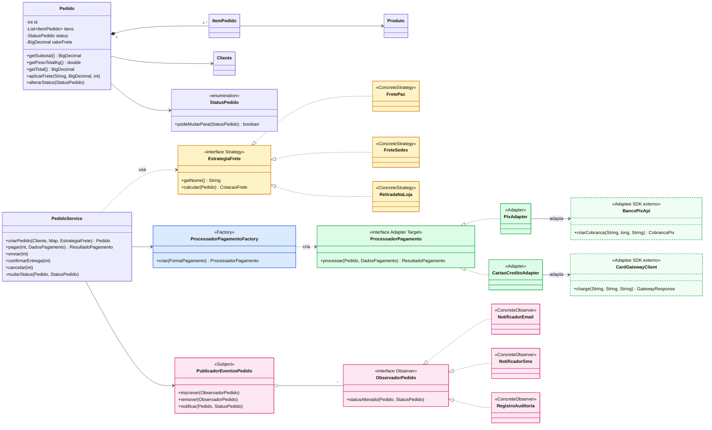

# Documentação Técnica — Sistema de Pedidos

## 1. Problema e contexto

Uma loja online pequena precisa de um backend que:

1. Monte pedidos a partir de um catálogo com **controle de estoque**.
2. Calcule o **frete** em três modalidades com regras diferentes (PAC, SEDEX, retirada na loja),
   escolhidas pelo cliente no checkout. O PAC tem uma regra própria: grátis acima de R$ 300.
3. Receba **pagamento por Pix e por cartão**, cada um por um fornecedor diferente, com SDKs
   de terceiros que **não podemos alterar** e que têm formatos incompatíveis entre si
   (Pix trabalha em centavos `long`; o gateway de cartão recebe `String`, responde código HTTP
   e mensagens de erro em inglês).
4. Controle o **ciclo de vida** do pedido (aguardando pagamento → pago → enviado → entregue,
   ou cancelado), impedindo transições inválidas.
5. A cada mudança de status, **avise várias partes independentes**: e-mail ao cliente, SMS
   (só se ele tiver telefone e só para eventos de entrega) e uma trilha de auditoria.

Por que esse problema justifica padrões de categorias diferentes: existem **três tensões
distintas** — (a) *criar* objetos que dependem de configuração externa, (b) *encaixar* APIs
de terceiros incompatíveis, (c) *variar comportamento* (frete) e *propagar eventos*
(notificações). Cada tensão pede uma categoria diferente de padrão; nenhum foi colocado
"para cumprir tabela".

### Escopo e simplificações assumidas
- Persistência em memória (o foco é o design, não o banco).
- Os SDKs de pagamento são **simulados** no pacote `pagamento/externo`, mas com regras
  reais de aprovação/recusa — o sistema funciona de ponta a ponta.
- E-mail e SMS são impressos no console.

---

## 2. Arquitetura

Arquitetura **em camadas**, com dependências sempre apontando "para dentro":

```
 apresentacao  (MenuConsole, Demonstracao, Formatador)
      │
      ▼
 aplicacao     (PedidoService — orquestra os casos de uso)
      │
      ├──► frete         (Strategy)
      ├──► pagamento     (Factory + Adapter) ──► pagamento/externo (SDKs de terceiros)
      ├──► notificacao   (Observer)
      ├──► repositorio   (memória)
      ▼
 dominio       (Pedido, ItemPedido, Produto, Cliente, StatusPedido — regras de negócio)
```

- **Domínio** não depende de nenhuma outra camada. `Pedido` valida a si mesmo (não aceita
  pedido sem item, não aceita transição de status inválida).
- **Aplicação** (`PedidoService`) é o único lugar que coordena estoque, frete, pagamento e
  notificação. Ela conhece só **interfaces** (`EstrategiaFrete`, `ProcessadorPagamento`,
  `ObservadorPedido`), nunca os gateways concretos.
- **`Main`** é a *raiz de composição*: o único ponto que dá `new` nas classes concretas e as
  injeta via construtor (injeção de dependência manual). Isso permite que os testes montem
  o sistema com outras peças.
- **Apresentação** só lê entrada e exibe — nenhuma regra de negócio mora nela.

### Fluxo de um pedido (sequência)

```
Menu → PedidoService.criarPedido(cliente, carrinho, estrategiaFrete)
         ├─ valida estoque de cada produto
         ├─ new Pedido(...)               (domínio valida itens)
         ├─ estrategiaFrete.calcular()    ◄── STRATEGY
         └─ repositorio.salvar()

Menu → PedidoService.pagar(id, dadosPagamento)
         ├─ revalida estoque
         ├─ fabrica.criar(forma)          ◄── FACTORY devolve um ProcessadorPagamento
         ├─ processador.processar()       ◄── ADAPTER traduz para o SDK do fornecedor
         └─ se aprovado: baixa estoque → mudarStatus(PAGO)
                                              └─ publicador.notificar()  ◄── OBSERVER
                                                   ├─ NotificadorEmail
                                                   ├─ NotificadorSms
                                                   └─ RegistroAuditoria
```

---

## 3. Diagrama de classes (UML)

Versão renderizada: abra [uml.html](uml.html) no navegador. Versão PlantUML:
[diagrama-classes.puml](diagrama-classes.puml). Os estereótipos `<<...>>` identificam o papel
de cada classe no padrão.



### Leitura do diagrama
- **Centro**: `PedidoService` depende só das interfaces (`EstrategiaFrete`,
  `ProcessadorPagamento`, `ObservadorPedido` via publicador) — por isso é estável.
- **Bloco Strategy**: uma interface, três implementações intercambiáveis.
- **Bloco Factory + Adapter**: a fábrica *cria* adapters; cada adapter *envolve* um SDK
  externo (Adaptee). Os dois padrões se complementam: o Adapter resolve a incompatibilidade
  de interface; a Factory resolve *qual* adapter montar e *com qual credencial*.
- **Bloco Observer**: o publicador mantém uma lista (agregação `o--`) de observadores.

---

## 4. Justificativa técnica de cada padrão

### 4.1 Factory (criacional) — `ProcessadorPagamentoFactory`

| Pergunta | Resposta |
|---|---|
| **Qual problema resolve?** | Para pagar, é preciso instanciar o SDK correto **com sua configuração** (chave Pix da loja, API key do gateway) e embrulhá-lo no adapter certo. Essa montagem não é responsabilidade do caso de uso "pagar pedido". |
| **Por que esse padrão?** | A decisão "qual objeto criar" depende de um dado de tempo de execução (`FormaPagamento` escolhida pelo cliente) e o chamador só precisa da interface `ProcessadorPagamento`. É exatamente o cenário da Factory: encapsular a criação e devolver uma abstração. |
| **Qual alternativa existia?** | (a) `if/else` com `new BancoPixApi()` dentro do `PedidoService`; (b) injetar todos os processadores prontos num `Map<FormaPagamento, ProcessadorPagamento>`; (c) GoF *Factory Method* / *Abstract Factory*. |
| **O que aconteceria sem ele?** | O `PedidoService` importaria `BancoPixApi`, `CardGatewayClient`, conheceria chaves e API keys, e cada nova forma de pagamento obrigaria a alterar o serviço central — violando Aberto/Fechado e Responsabilidade Única. |
| **Impacto na manutenção** | Nova forma (ex.: boleto) = novo valor no enum + novo adapter + **um `case`** na fábrica. O `PedidoService` não é tocado. Trocar credenciais ou fornecedor também fica isolado aqui. |

Por que **Simple Factory** e não Factory Method/Abstract Factory: não há famílias de
produtos relacionados nem hierarquia de criadores. Uma classe com um `switch` resolve; as
variantes GoF adicionariam classes sem benefício (ver análise crítica).

### 4.2 Adapter (estrutural) — `PixAdapter`, `CartaoCreditoAdapter`

| Pergunta | Resposta |
|---|---|
| **Qual problema resolve?** | Dois fornecedores com **interfaces incompatíveis** que não podemos modificar: `BancoPixApi.criarCobranca(chave, long centavos, descricao)` → `CobrancaPix("CONCLUIDA")` vs `CardGatewayClient.charge(token, "123.45", "BRL")` → `GatewayResponse(402, "card_declined")`. |
| **Por que esse padrão?** | É a definição literal do Adapter: converter a interface de uma classe existente (Adaptee) na interface que o cliente espera (Target = `ProcessadorPagamento`). |
| **Qual alternativa existia?** | Chamar os SDKs direto no serviço com `if (forma == PIX) {...centavos...} else {...http status...}`; ou uma *Facade* única para os dois. |
| **O que aconteceria sem ele?** | Detalhes de fornecedor (centavos, códigos HTTP, mensagens em inglês) vazariam para a regra de negócio. Trocar de gateway de cartão exigiria reescrever o `PedidoService`. Testar o serviço sem os SDKs seria difícil. |
| **Impacto na manutenção** | Cada tradução fica num único arquivo. Se o banco mudar o SDK, só o `PixAdapter` muda. O resto do sistema vê sempre o mesmo `ResultadoPagamento` padronizado, com mensagens em português (`traduzirErro`). |

Por que não Facade: Facade *simplifica* um subsistema complexo; aqui o problema não é
complexidade, é **incompatibilidade** entre duas APIs que precisam ser intercambiáveis
atrás do mesmo contrato.

### 4.3 Strategy (comportamental) — `EstrategiaFrete`

| Pergunta | Resposta |
|---|---|
| **Qual problema resolve?** | Três algoritmos de frete diferentes (base + peso, prazos distintos, regra de frete grátis só no PAC), escolhidos pelo **cliente no checkout**, em tempo de execução. |
| **Por que esse padrão?** | Família de algoritmos intercambiáveis com a mesma assinatura (`calcular(Pedido)`), em que o contexto (`PedidoService`) não deve saber qual está usando. |
| **Qual alternativa existia?** | Um `switch (tipoFrete)` com as fórmulas dentro do serviço ou do `Pedido`; ou um enum com método abstrato. |
| **O que aconteceria sem ele?** | Um método com vários `if` misturando regras: a regra "PAC grátis acima de R$ 300" ficaria ao lado da fórmula do SEDEX, e qualquer nova modalidade (transportadora, motoboy) mexeria no mesmo método — alto risco de regressão. |
| **Impacto na manutenção** | Nova modalidade = nova classe que implementa `EstrategiaFrete` + incluí-la na lista do menu. Cada regra é testável isoladamente (ver `TestesSistema`). |

### 4.4 Observer (comportamental) — `PublicadorEventosPedido` / `ObservadorPedido`

| Pergunta | Resposta |
|---|---|
| **Qual problema resolve?** | Uma mudança de status precisa disparar **várias reações independentes** (e-mail, SMS condicional, auditoria), e a lista de reações cresce com o tempo. |
| **Por que esse padrão?** | Relação um-para-muitos em que o emissor não deve conhecer os receptores. Cada observador decide sozinho o que lhe interessa (o SMS ignora clientes sem telefone e eventos que não são de entrega). |
| **Qual alternativa existia?** | Chamar `email.enviar()`, `sms.enviar()`, `auditoria.registrar()` diretamente em cada método do serviço (`pagar`, `enviar`, `cancelar`...). |
| **O que aconteceria sem ele?** | As chamadas seriam repetidas em cinco lugares; esquecer uma em um caso de uso gera bug silencioso; adicionar "notificar WhatsApp" mexeria em todos os métodos. Uma falha no SMS poderia derrubar o pagamento. |
| **Impacto na manutenção** | Nova reação = nova classe + uma linha `inscrever(...)` no `Main`. O `try/catch` por observador no publicador garante que **uma falha de notificação nunca desfaz um pagamento** (coberto por teste). |

Detalhe de design: existe **um único ponto** de mudança de status (`PedidoService.mudarStatus`),
então é impossível mudar status sem notificar.

---

## 5. Análise crítica

### 5.1 Onde deliberadamente **NÃO** usamos padrão

| Lugar | Padrão "tentador" | Por que não usamos |
|---|---|---|
| `StatusPedido` | **State** | 5 estados, regra de transição de uma linha, nenhum comportamento diferente por estado. State criaria 5 classes para substituir um `switch` de 10 linhas. Se no futuro cada estado tiver comportamento próprio (ex.: regras de reembolso diferentes), aí sim vale migrar. |
| `Pedido` | **Builder** | O pedido tem 3 parâmetros obrigatórios no construtor (id, cliente, itens) e o construtor já valida o invariante principal. Builder só faria sentido com muitos opcionais (cupom, embrulho, agendamento...). |
| Repositórios | **Singleton** | Singleton seria um estado global escondido e dificultaria os testes (cada teste monta repositórios novos). Usamos uma instância criada no `Main` e injetada. |
| Repositórios | Interface + implementação | Só existe a versão em memória. Criar `IRepositorio` agora seria abstração especulativa (YAGNI). Se entrar um banco de dados, extrair a interface é uma refatoração simples. |
| Descontos/cupons | **Decorator** | Não há requisito de desconto. Implementar "para mostrar" seria padrão sem problema. |
| `PedidoService` | **Facade** | O serviço já é um ponto de entrada simples; chamá-lo de Facade seria só renomear algo que já existe. |
| `DadosPagamento.pix()` / `cartao()` | — | São *static factory methods* (idioma do Java), não o padrão GoF. Usados só para legibilidade; não os contamos como "o padrão criacional" do trabalho. |

### 5.2 Complexidade introduzida
- **Número de classes**: frete passou de 1 método para 1 interface + 3 classes + `CotacaoFrete`;
  pagamento tem 1 interface + 2 adapters + 1 fábrica + 3 classes de apoio. Para um leitor
  novo, o fluxo de "pagar" exige abrir 3–4 arquivos.
- **Indireção**: ao ler `processador.processar(...)` não se sabe, sem a fábrica, qual
  gateway roda — o custo clássico de programar para interfaces.
- **Observer esconde o fluxo**: ao ler `mudarStatus()` não se vê quem é notificado; é preciso
  olhar o `Main`. Depurar a ordem de execução fica menos óbvio.

### 5.3 Trade-offs

| Ganho | Custo |
|---|---|
| Serviço central estável, aberto a extensão (nova forma de pagamento, novo frete, nova notificação sem tocar no `PedidoService`) | Mais arquivos e mais indireção |
| Regras isoladas e testáveis uma a uma | Fluxo "espalhado" — exige o diagrama para entender |
| Falha de notificação não afeta o pagamento | Observer **síncrono**: um observador lento (SMS real com timeout) atrasa a resposta do pagamento. Em produção, o próximo passo seria uma fila assíncrona. |
| Simple Factory é curta e clara | O `switch` ainda precisa ser editado para cada nova forma (não é 100% fechado para modificação) — aceitamos porque a alternativa (registro dinâmico/reflexão) seria complexidade desproporcional. |

### 5.4 Limitações conhecidas (honestidade técnica)
- **Estoque não é transacional**: em concorrência real, dois pagamentos simultâneos poderiam
  passar na revalidação. Num sistema real, isso exige transação/lock no banco.
  Por isso a baixa de estoque **não** foi feita por Observer: é regra crítica e precisa
  acontecer junto com o pagamento, não como "reação opcional".
- **Cancelamento de pedido pago** devolve estoque, mas não chama estorno no gateway
  (fora do escopo; seria um novo método na interface `ProcessadorPagamento`).
- Pix com confirmação imediata é uma simplificação: na realidade seria assíncrono (webhook).

---

## 6. Testes

`test/loja/TestesSistema.java` — 19 verificações, sem framework, cobrindo cada padrão:

- Strategy: valor do SEDEX por peso, PAC grátis ≥ R$ 300, retirada sem custo.
- Factory + Adapter: Pix aprovado com txid; cartão recusado não altera status/estoque e não
  notifica; erro do gateway traduzido para português; limite acima de R$ 5.000.
- Observer: observador que lança exceção não impede o pagamento nem os demais observadores.
- Regras: envio sem pagamento bloqueado; cancelamento devolve estoque; estoque insuficiente.
